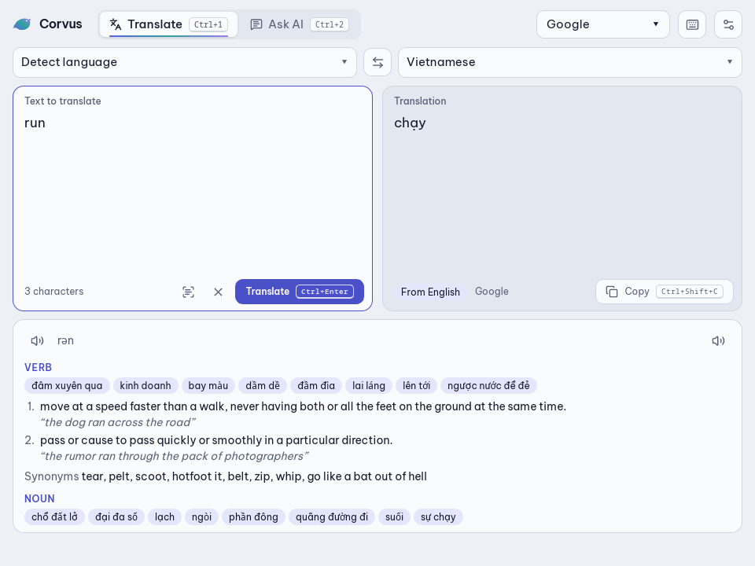
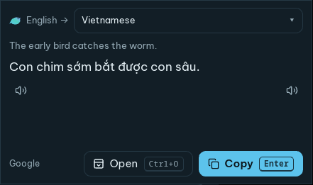

# Corvus

A keyboard-first desktop translator and AI assistant.





## Install

Download from [Releases](https://github.com/atuan26/corvus/releases).

- **Windows**: `Corvus_<version>_x64-setup.exe` (unsigned: **More info → Run anyway**)
- **Debian/Ubuntu**: `sudo apt install ./Corvus_<version>_amd64.deb`
- **Fedora/openSUSE**: `sudo dnf install ./Corvus-<version>-1.x86_64.rpm`
- **Other Linux**: `Corvus_<version>_amd64.AppImage`
- **macOS**: `Corvus_<version>_universal.dmg` (first run: right-click → **Open**)

## Shortcuts

| Keys | Action |
|---|---|
| Ctrl+Alt+C | Show Corvus |
| Ctrl+Alt+E | Translate selection in a popup |
| Ctrl+Alt+R | Replace selection with its translation |
| Ctrl+Alt+A | Ask AI about the selection |
| Ctrl+Alt+O / Ctrl+Alt+I | Translate / copy text from a screen area |
| Ctrl+/ | All in-app shortcuts |

On Wayland, bind these in your desktop's settings instead:

```sh
corvus-app --translate-selection | --replace-selection | --ask-selection | --ocr-translate | --ocr-copy
```

## CLI

```sh
corvus translate -t vi "Hello"
corvus ocr shot.png --translate
corvus key set deepl
```

## Build

Needs Rust, Node.js 24 and pnpm 11. On Debian/Ubuntu also:

```sh
sudo apt install libwebkit2gtk-4.1-dev libayatana-appindicator3-dev librsvg2-dev libasound2-dev libdbus-1-dev patchelf
```

```sh
pnpm install
pnpm tauri dev      # run
pnpm tauri build    # packages in target/release/bundle/
cargo test --workspace
```

## License

[MIT](LICENSE)
